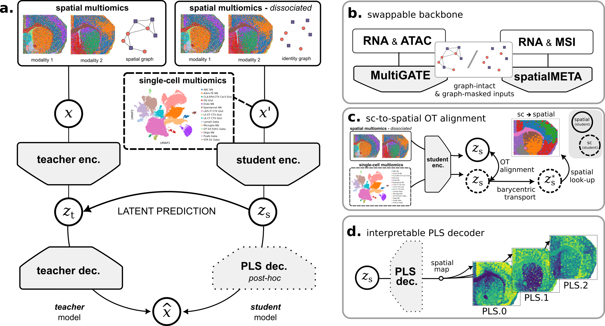

# SpatialJEPA

SpatialJEPA carries tissue context from spatial multiomics into molecular representations that need no
spatial coordinates. A **teacher** encoder receives spatial multiomic profiles with their tissue-neighbourhood
graph. A **student** encoder predicts the teacher's latent representation from the same profiles with the
graph masked to self-loops. The trained student can then be applied, without retraining, to dissociated
single-cell data.

The framework is backbone-agnostic. This repository contains two backbones:
- **MultiGATE** for spatial RNA–ATAC (`MultiGATE/`);
- a graph-augmented **SpatialMETA** for spatial transcriptome–metabolome (RNA–MSI) data
  (`spatialjepa/spatialmeta_backbone.py`).

It also contains every script behind the results of the manuscript:

> Mann-Krzisnik D, Li Y. *SpatialJEPA transfers tissue and metabolic context from spatial multiomics to
> non-spatial single-cell data.* Genome Research (submitted, 2026).



## Repository

| Path | Content |
|---|---|
| `MultiGATE/` | MultiGATE with graph-context distillation (teacher, student, distillation objective) |
| `spatialjepa/` | SpatialMETA-backbone SpatialJEPA model; `paths.py` (all settings); `mlflow_offline.py` |
| `rna_atac/` | Spatial RNA–ATAC (P22 mouse brain → 10x Multiome): feature alignment, training, analysis, figures |
| `rna_msi/` | Spatial RNA–MSI (mouse PD model): training, target encoding, dopamine program, held-out animals, figures (`supplement/`: supplementary controls) |
| `human_cah/` | Transfer of the human RNA–MSI model to SEA-AD caudate-head snRNA-seq and Xenium |
| `shared/` | Feature alignment and evaluation utilities |
| `envs/` | Conda environments (direct dependencies pinned to the versions used), `install.sh`, exact lock files |
| `configs/` | `spatialjepa.env.example`: data location and interpreters |
| `reproduce.sh` | Reproduces the manuscript figures, analyses and models, step by step |
| `docs/` | [REPRODUCIBILITY.md](docs/REPRODUCIBILITY.md) (figure → step → script), [DATA.md](docs/DATA.md), [PROVENANCE.tsv](docs/PROVENANCE.tsv) |
| `tools/` | `export_mlflow_run.py` (MLflow run → folder for offline use), `make_deposit_archives.sh` (Zenodo archives), `make_supplemental_code.sh` (journal Supplemental Code) |
| `tests/` | Smoke tests |

## Installation

The analyses ran in five conda environments, one per stage. `envs/install.sh` creates them; it needs conda and
a C/C++ compiler:

```bash
envs/install.sh                  # all five; or e.g. envs/install.sh msi analysis
```

| Environment | Used for |
|---|---|
| `spatialjepa-msi` | SpatialMETA-backbone training and encoding (Python 3.9, PyTorch 2.2.2 + CUDA 12.1, PyG 2.6.1) |
| `spatialjepa-analysis` | MultiGATE backbone, analyses and most figures (Python 3.10; includes R 4.3 with Seurat/SCTransform) |
| `spatialjepa-scvi` | MultiVI baseline and three RNA–ATAC figure scripts (scvi-tools 1.3.3) |
| `spatialjepa-multigrate` | Multigrate baseline (multigrate 0.0.2, scvi-tools 1.0.4) |
| `spatialjepa-motifs` | Motif scans (MOODS, pyjaspar) |

Each `envs/spatialjepa-*.yml` pins every package that the scripts import, and everything those packages
require, to the version that ran. `install.sh` then adds five packages without dependency resolution
(`envs/no-deps.txt`). Most ran next to versions that their own metadata excludes (for example leidenalg 0.10.1
with igraph 1.0.0); SpatialMETA and pybedtools 0.9.1 must also be built against the environment's own packages.
Four infrastructure packages that also ran next to excluded versions are left to pip: protobuf, cryptography,
fsspec and packaging. `envs/lock/` lists every package as it ran. The Python 3.10 environments were extended by
packages in the user site (`~/.local`); the versions listed are those whose files were loaded. Set `PYTHONNOUSERSITE=1` if you have packages in `~/.local`, so that
they do not shadow the environments. The Fig. 3 assembly renders SVG with the system librsvg and cairo
libraries (run in the motifs environment). Training was done on NVIDIA GPUs (RTX 2080 Ti, 11 GB); the CaH
imputation needs more than 40 GB of RAM.

Copy `configs/spatialjepa.env.example` to `configs/spatialjepa.env`, then set `SPATIALJEPA_HOME` and the
interpreter of each environment. Scripts find the repository packages without installation; optionally
`pip install -e .`.

## Reproducing the manuscript

1. Download the deposit (Zenodo DOI: [10.5281/zenodo.23933515](https://doi.org/10.5281/zenodo.23933515)) and unpack it into `SPATIALJEPA_HOME`.
2. Add the public data listed in [docs/DATA.md](docs/DATA.md).
3. Run:

```bash
./reproduce.sh figures        # every figure from the deposited models (~2 h, one GPU)
./reproduce.sh analyses       # recompute the deposited intermediates (the held-out-animal benchmark retrains its 162 runs)
./reproduce.sh train          # retrain the models (RETRAIN_SUFFIX=_retrained keeps the deposited ones)
./reproduce.sh list           # individual steps
```

Figures are written under `$SPATIALJEPA_HOME/outputs/manuscript/figures/`, with the manuscript's file names.

What was verified:
- **Figures.** `./reproduce.sh figures` was run on the deposit plus the public data, and each figure was
  compared with the file in the manuscript. Fig. 4 and Supplemental Figs. S1, S3–S12 and S14–S17 are
  byte-identical. The panels of Figs. 2f–g, 3 and 5 are byte-identical to the panel files those figures were
  assembled from.
- **Hand-finished figures.** Figs. 1–3 and the final layout of Fig. 5 were arranged by hand. S2 and S13 in the
  manuscript are a re-export and a crop of the script output.
- **Training.** Retraining the mouse RNA–MSI model reproduced its weights and embeddings bit for bit on the
  same hardware.
- **Environments.** All five environments were rebuilt from scratch with `envs/install.sh`, and
  `./reproduce.sh figures` was run again with them. Every figure was byte-identical to the one from the
  original environments except S10, where a few pixels differ by one intensity level. The rebuilt `msi`
  environment encodes the deposited mouse model to bit-identical latents.

[docs/REPRODUCIBILITY.md](docs/REPRODUCIBILITY.md) has the details.

The RNA–ATAC training run was tracked with MLflow. Its checkpoints and its run record are in the deposit
(`outputs/rna_atac_models/20260505_190037/`). The run record has the parameters in `run.json` and the metric
histories in `metrics/`, exported with `tools/export_mlflow_run.py`. `rna_atac/analyze_rna_atac.py` reads that
folder in place of a tracking server (`spatialjepa/mlflow_offline.py`). To use a live server instead, set
`MLFLOW_TRACKING_URI`.

## Running SpatialJEPA on new data

- **RNA–MSI** (`rna_msi/train_rna_msi.py`). Sections are read from `data/vicari_2023/h5mu_export/` and
  settings from `SPATIALJEPA_*` environment variables: sections, run tag, seed, target panel size, teacher
  neighbourhood, teacher early stopping. See `reproduce.sh` (`msi_env`). Encode new targets with
  `rna_msi/encode_targets.py` or `human_cah/encode_nuclei.py`.
- **RNA–ATAC** (`rna_atac/train_rna_atac.py --help`). The source and target are aligned first with
  `rna_atac/align_features.py`.

## License and citation

SpatialJEPA is released under the MIT License. The `MultiGATE/` package derives from
[MultiGATE](https://github.com/aqlkzf/MultiGATE) (Miao et al., *Nature Communications* 2025) and keeps its
Apache-2.0 license (`MultiGATE/LICENSE`, `NOTICE`). SpatialMETA is a pinned dependency (BSD-3-Clause).

Please cite the article above (see `CITATION.cff`) and, where appropriate, MultiGATE and SpatialMETA. A
preliminary version of the spatial RNA–ATAC results appeared at CIBB 2026.
